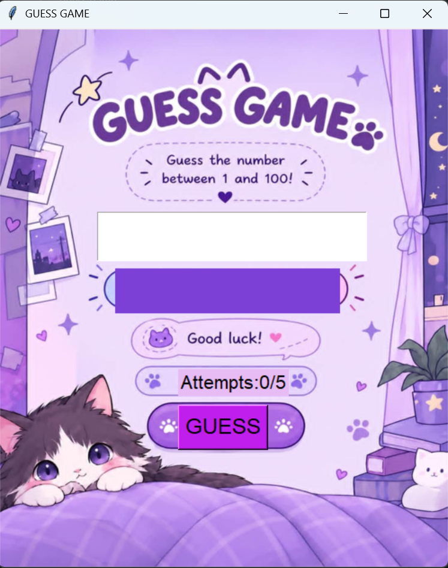

# number-guessing-game
A simple Python number guessing game with 5 attempts.
# 🎯 Number Guessing Game

A simple number guessing game built with Python.

## 🎮 How to Play

- The computer chooses a secret number between 1 and 100.
- You have 5 attempts to guess the correct number.
- After each guess, the game gives you a hint.
- Try to find the secret number before you run out of attempts!

## ✨ Features

- Random number between 1 and 100
- 5 attempts to guess the number
- Helpful hints after each guess
- Simple and fun gameplay

## 🛠️ Built With

- Python

## ▶️ How to Run

1. Install Python.
2. Download or clone this repository.
3. Run the Python file.

## 💜 About

A beginner-friendly Python project created to practice programming logic, conditional statements, loops, and random numbers.
